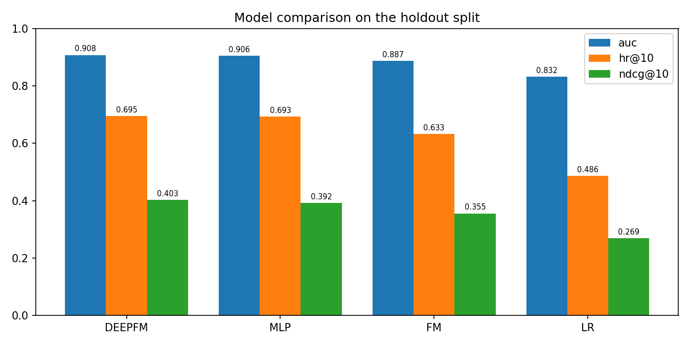
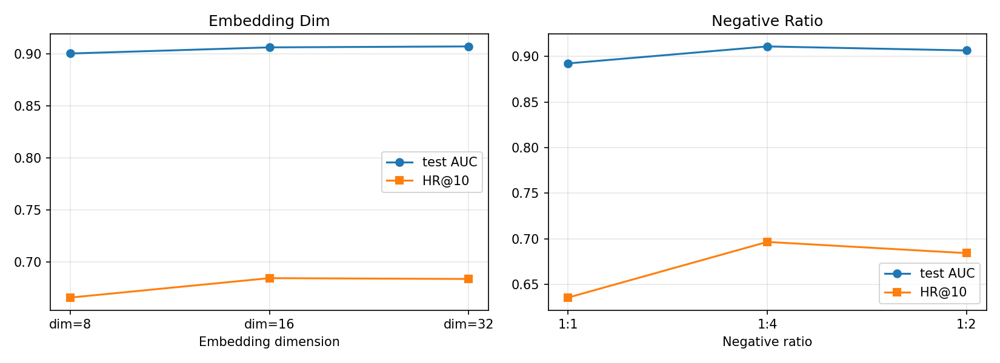

# 基于 PyTorch 的 DeepFM 推荐系统

> 从零实现 LR / FM / MLP / DeepFM，在 MovieLens-1M 上做 CTR 式推荐与排序评估。
>
> From-scratch PyTorch CTR models (LR, FM, MLP, DeepFM) for MovieLens-1M,
> with leave-one-out evaluation, negative sampling and a FastAPI serving layer.


---

## 核心结果

<!-- RESULTS_START -->
留出测试集（每个用户 1 个正样本 + 99 个负样本，6040 个用户）：

| 模型 | 参数量 | 训练时间 | 验证 AUC | 测试 AUC | HR@10 | NDCG@10 | HR@20 |
|---|---:|---:|---:|---:|---:|---:|---:|
| **DeepFM** | 241,584 | 12.8 min | **0.9187** | **0.9080** | **0.6949** | **0.4030** | **0.8510** |
| MLP | 241,584 | 7.9 min | 0.9167 | 0.9061 | 0.6925 | 0.3922 | 0.8510 |
| FM | 181,935 | 4.8 min | 0.8994 | 0.8869 | 0.6330 | 0.3554 | 0.8051 |
| LR | 181,935 | 2.6 min | 0.8438 | 0.8316 | 0.4862 | 0.2686 | 0.6779 |



三点结论：

1. **二阶交叉是最大的单步收益**：LR → FM 将 AUC 从 0.832 提到 0.887，HR@10 从 0.486 提到 0.633。
2. **非线性塔再加一层**：FM → MLP 的 AUC 再 +1.9 个点，HR@10 +6.0 个点。
3. **DeepFM 的增益很小**：相对 MLP 仅 +0.2 个点 AUC，NDCG@10 +1.1 个点。说明在这套特征上，FM 与 MLP 的表达有较大重叠——这是可以坦诚讨论的结论，而不是硬吹 DeepFM 全面领先。

> 注：四个模型使用相同的 15 轮训练预算与早停策略；本轮所有模型都跑满了 15 轮（验证 AUC 仍在缓慢上升），因此绝对指标还有提升空间。参数量中含共享 Embedding 表（约 18 万），LR 的线性权重本身只有约 1.1 万。
<!-- RESULTS_END -->


---

## 项目做了什么

不使用现成推荐库，四个模型全部用 PyTorch 手写：

| 模型 | 结构 | 文件 |
|---|---|---|
| **LR** | 每个特征一个权重，线性打分 | `models/deepfm.py` |
| **FM** | 线性项 + 二阶特征交叉 `0.5·((Σe)² − Σe²)` | `models/layers.py` |
| **MLP** | 线性项 + Embedding 拼接后过 MLP | `models/deepfm.py` |
| **DeepFM** | 线性项 + FM + MLP，共享 Embedding | `models/deepfm.py` |

评估同时覆盖**排序**与**CTR**：

- `AUC` / `LogLoss`：候选集上的点击概率判别能力
- `HR@10 / 20`、`NDCG@10 / 20`：每个用户 1 个正样本 + 99 个负样本的排序质量

---

## 数据与评估协议

MovieLens-1M：6040 个用户、约 100 万条评分、3883 部电影。

1. **正样本**：评分 ≥ 4 的交互
2. **留一法切分**：每个用户按时间排序，最后一条正样本作测试集，倒数第二条作验证集
3. **训练负采样**：每条正样本配 2 个用户未评分的电影（可配置）
4. **验证/测试**：每个用户 1 个正样本 + 99 个未评分电影，计算排序与 CTR 指标
5. **特征**（25 个类别字段）：用户 ID、性别、年龄、职业、邮编前缀；电影 ID、年代；18 个类型标记
6. 未见过的类别 ID 映射到保留索引 0，支持冷启动

这一协议避免了两个常见错误：随机切分导致未来信息泄漏，以及用已交互物品当负样本。

---

## 消融实验

固定 DeepFM、10 轮训练预算，分别改变 Embedding 维度与训练负采样比例（`reports/ablation.csv`）：

| Embedding 维度 | 测试 AUC | HR@10 | NDCG@10 | 训练时间 |
|---:|---:|---:|---:|---:|
| 8 | 0.9006 | 0.6656 | 0.3767 | 6.8 min |
| **16** | **0.9065** | **0.6843** | **0.3926** | 8.2 min |
| 32 | 0.9074 | 0.6835 | 0.3924 | 8.8 min |

| 负采样比例 | 测试 AUC | HR@10 | NDCG@10 | 训练时间 |
|---:|---:|---:|---:|---:|
| 1 : 1 | 0.8923 | 0.6356 | 0.3574 | 4.0 min |
| 1 : 2 | 0.9065 | 0.6843 | 0.3926 | 8.2 min |
| **1 : 4** | **0.9109** | **0.6966** | **0.4098** | 11.2 min |



- **8 维明显欠拟合**；16 → 32 维只多 0.09 个 AUC 点，却多 7% 训练时间，因此 16 维是性价比最优。
- **负样本越多，判别力越强**：1:2 → 1:4 再 +0.44 个 AUC 点、HR@10 +1.2 点。但训练时间接近翻倍，且训练分布会进一步偏离线上真实分布，不能无限加。

---

## 项目结构

```text
ctr-deepfm-pytorch/
├── configs/default.yaml       # 数据、模型、训练配置
├── src/recsys/
│   ├── data/                  # 解析 ml-1m、特征编码、留一法切分与负采样
│   ├── models/                # Embedding/线性/FM/MLP 层与四个模型
│   ├── train/                 # 训练循环、早停、AUC/HR/NDCG
│   ├── serving/               # Recommender、Pydantic Schema、FastAPI
│   ├── experiments.py         # 模型对比与消融
│   └── cli.py                 # `ctr` 命令行
├── tests/                     # 18 个单元/API 测试
├── scripts/download_data.py   # 下载并解压 MovieLens
├── Dockerfile / Makefile / pyproject.toml
```

| 模块 | 职责 |
|---|---|
| `data/loader.py` | 解析 `ratings/users/movies.dat`，提取年代与类型 |
| `data/features.py` | 类别词表、冷启动保留位、训练/服务共用编码 |
| `data/split.py` | 留一法切分、负采样、用户历史 |
| `models/layers.py` | 字段偏移 Embedding、线性层、FM 交叉、MLP |
| `train/trainer.py` | 手写训练循环、早停、按批推理 |
| `serving/recommender.py` | Top-K 排序、已看过滤、冷启动画像 |

---

## 快速开始

### 1. 安装

```bash
python -m venv .venv
# Windows: .venv\Scripts\activate
source .venv/bin/activate
pip install -e ".[dev]"
```

PyTorch 默认从 PyPI 安装；如需 CPU 专用包：

```bash
pip install torch --index-url https://download.pytorch.org/whl/cpu
```

### 2. 下载数据

```bash
python scripts/download_data.py
# 网络受限时：浏览器下载 ml-1m.zip 放到 data/raw/，再执行
python scripts/download_data.py --skip-download
```

### 3. 训练与对比

```bash
ctr prepare                 # 切分 + 编码，约 1 分钟
ctr train --model deepfm    # 训练 DeepFM 并保存服务 bundle
ctr compare                 # 四个模型完整对比
ctr ablation                # Embedding 维度与负采样比例消融
```

### 4. 启动推荐服务

```bash
ctr serve --port 8000
# Swagger: http://127.0.0.1:8000/docs
```

```bash
curl -X POST http://127.0.0.1:8000/recommend \
  -H "Content-Type: application/json" \
  -d '{"user_id": 1, "top_k": 5}'
```

冷启动（用户不在训练集）：

```json
{
  "user_id": 99999,
  "top_k": 5,
  "profile": {"gender": "M", "age": "35", "occupation": "2", "zip_prefix": "456"}
}
```

---

## 服务接口

| 方法 | 路径 | 说明 |
|---|---|---|
| GET | `/health` | 模型加载状态 |
| GET | `/model/info` | 模型名、用户/电影数、评估指标 |
| POST | `/recommend` | 给定用户返回 Top-K 电影（可选过滤已看） |
| POST | `/score` | 对指定候选电影打分 |

---

## 工程与测试

- 18 个测试：数据切分、负采样、特征编码、FM 数学、指标、模型前向、API
- `ruff` 静态检查，GitHub Actions 自动运行
- Docker 多阶段构建（CPU 版 PyTorch），非 root + 健康检查

### Docker

```bash
docker build -t ctr-deepfm:latest .
docker run -p 8000:7860 ctr-deepfm:latest

# 国内网络：torch 走阿里云 wheel 镜像，pip 与 apt 走清华镜像
docker build -t ctr-deepfm:latest . \
  --build-arg PIP_INDEX_URL=https://pypi.tuna.tsinghua.edu.cn/simple \
  --build-arg TORCH_FIND_LINKS=https://mirrors.aliyun.com/pytorch-wheels/cpu/ \
  --build-arg APT_MIRROR=mirrors.tuna.tsinghua.edu.cn
```

---

## 设计取舍

- **不做分布式 / 特征存储**：单机 CPU、百万级样本，引入重型组件只会增加讲述成本
- **只用单次留一法**：没有做交叉验证或 bootstrap 置信区间，这是明确的局限
- **负样本只排除已评分物品**：未曝光物品仍可能被当作负样本，存在假阴性

---

## 局限与改进方向

1. 结果对随机种子和负采样分布敏感，缺少多次运行的均值/方差
2. 没有做冷启动用户的系统评估（当前只有接口层面的支持）
3. 未引入序列模型（DIN/DIEN）或图模型，推荐链路仍偏 CTR 静态特征
4. 线上服务没有监控与漂移检测，可复用房价项目的 PSI 方案

---

## 数据来源

[MovieLens-1M](https://grouplens.org/datasets/movielens/1m/)，GroupLens Research，用于学术研究。
